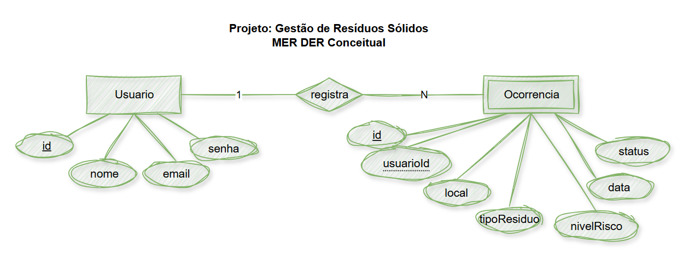
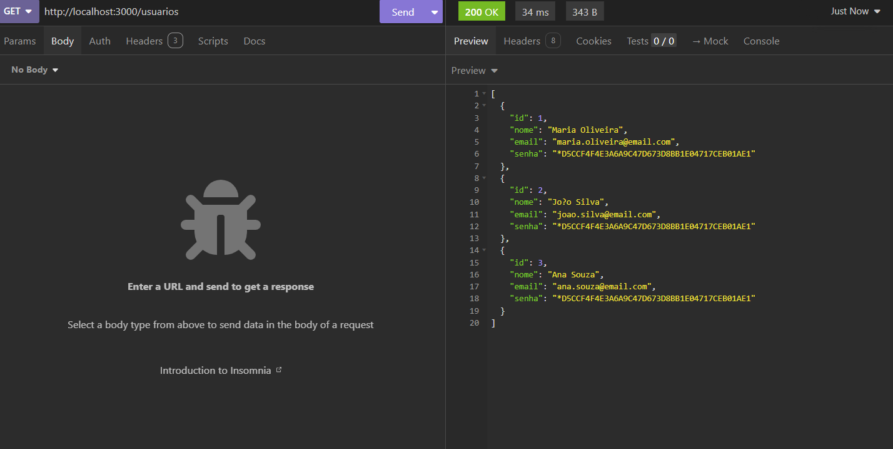
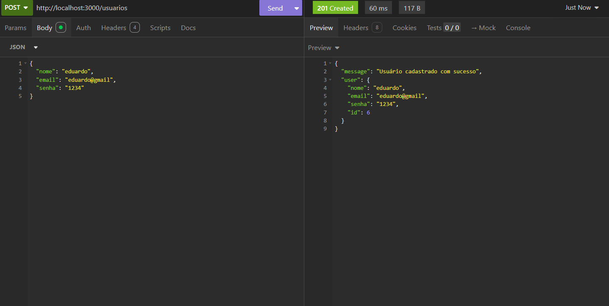
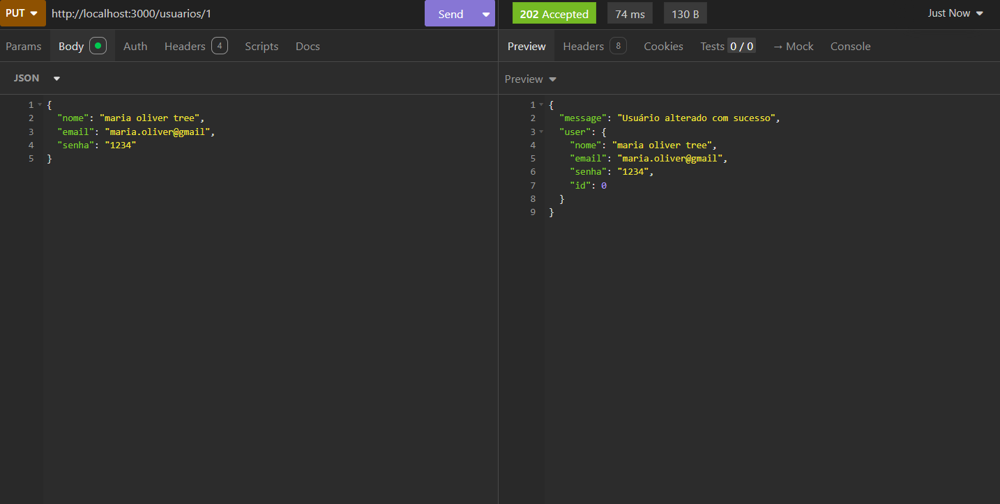
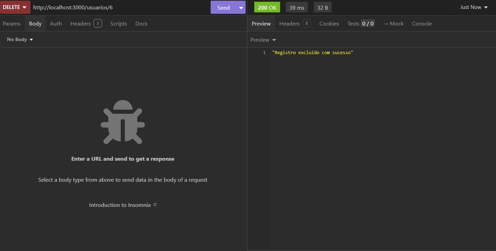
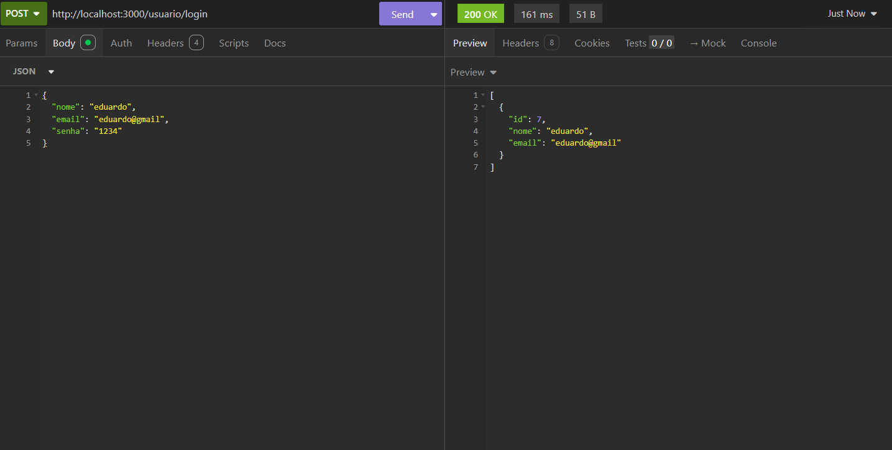
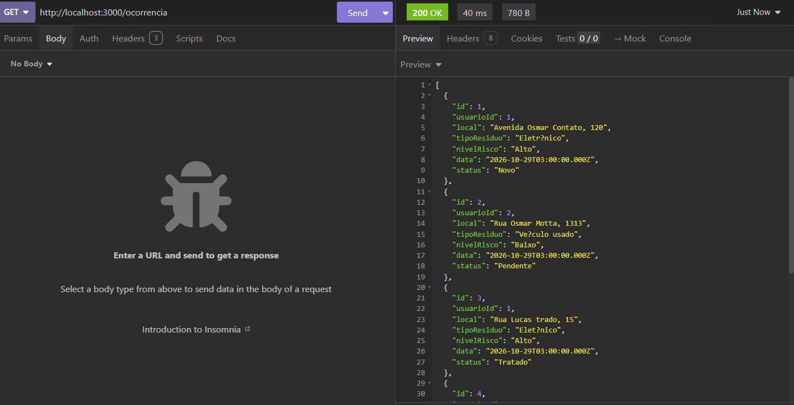
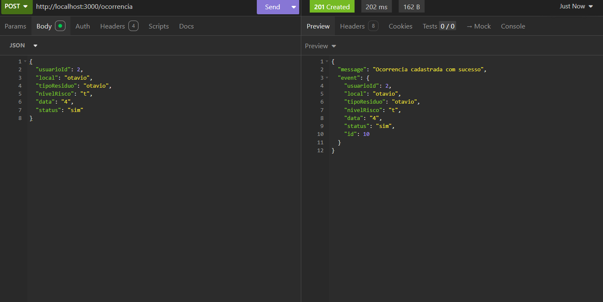
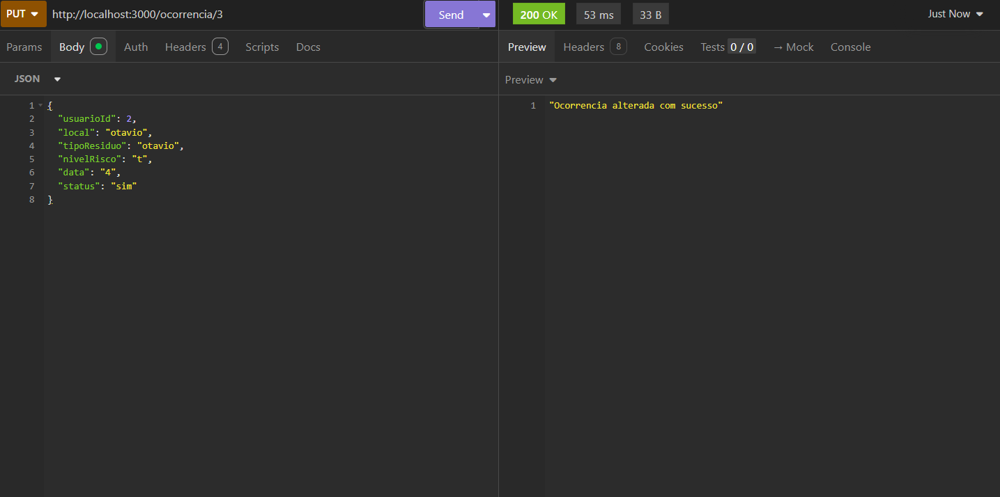
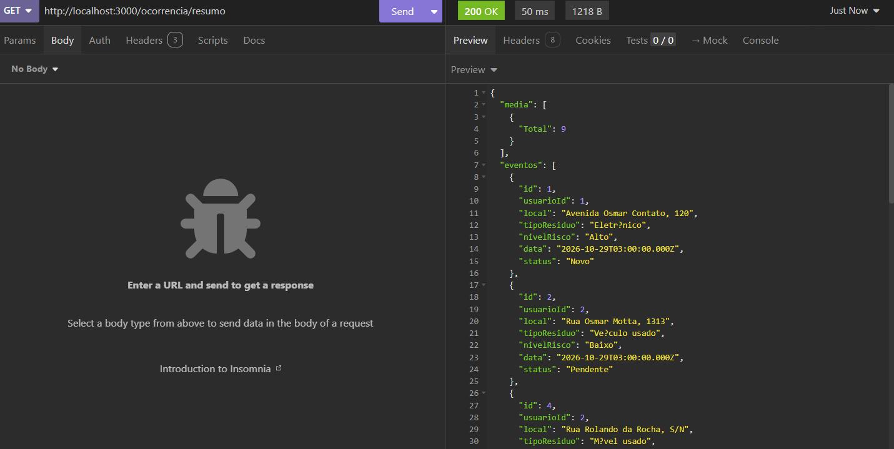

# Gestão de resíduos Sólidos

## Descrição
Atividade 1 de backend com **CRUDS** e Banco de Dados

## Diagrama de classes

## Tecnologias
- Node modules
- Vs code
- Insomnia
- Maria DB

## Passo a passo para testar
1. Clone este repositório e abra com o vs code
2. Rode `npm run dev` no terminal
3. Ligue o XAMPP e cole o **db/script.sql**
4. Abra o insominia e teste com `http://localhost:3000`

# Prints
## Usuario

## Ocorrencia

